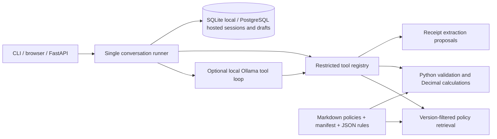

# Architecture

Browser image processing: `browser` OCR uses self-hosted Tesseract.js workers, WebAssembly,
and English data on the user's device. Only untrusted `receipt_ocr_text` reaches the API;
the existing text model proposes fields. Static files are included in the wheel and Vercel
function, with no Node build or native OCR dependencies. Browser OCR runs outside the
function timeout. Its server-side evidence hash covers received OCR text, not original
image bytes. See [browser OCR](browser-ocr.md).

Optional local image processing: the Florence OCR backend reads PNG/JPEG bytes and passes
untrusted text to the same text-model receipt extractor. It uses native Transformers with
the documented Florence-2 base checkpoint and cached weights. The default image backend
(`vision`) sends images to a compatible vision model. OCR/model extraction only proposes
fields; explicit evidence review, policy retrieval, validation, calculation, and saving are
controlled by the existing runner. See [Florence setup](florence-receipts.md).

The runner holds a per-turn Pydantic state loaded from SQLite, not mutable global conversation
state. Tools return an `ok/data/code/message` envelope. The LLM may propose claim fields and
search policies, with at most four rounds and four calls per round. It cannot assert business
eligibility, confirm evidence, calculate, or save. The runner invokes deterministic tools after
the user turn and constructs the final amount/citation message from their results.

Offline retrieval uses sparse hashed lexical vectors; no embedding API or vector service is
required. The stored index includes a source digest. Ingestion reads the manifest; retrieval
filters by expense-date validity. Rules are selected independently from retrieval.

SQLite uses parameterized queries, optimistic revisions, foreign keys, and atomic session/draft
writes. Unique evidence hashes and canonical receipt fingerprints prevent reuse within this
assistant. State/history survive process restarts. Live model/server processes must restart.

Vercel uses the same repository operations against PostgreSQL configured through
CLAIMS_DATABASE_URL. User records persist outside the function; only the policy index is
rebuilt in /tmp on a cold start. Cloud startup accepts public mode without a service token,
or private mode with one. Demo app mode remains loopback-only.

Public mode generates an anonymous HttpOnly visitor cookie, Secure on HTTPS/Vercel and
SameSite=Strict. Only its SHA-256 hash is stored in session_owners, atomically with each new
session. All public session reads/chat mutations/draft exports require matching ownership;
unowned old records stay private. This works across function instances without a signing
key or in-memory identity map. Private mode retains shared-token access to all records.

This is standalone: exported JSON is a downloadable artifact. Anonymous browser workspaces
are not verified employee identities. Employee login, operational controls, and approved
rules remain necessary for real organizational use.
