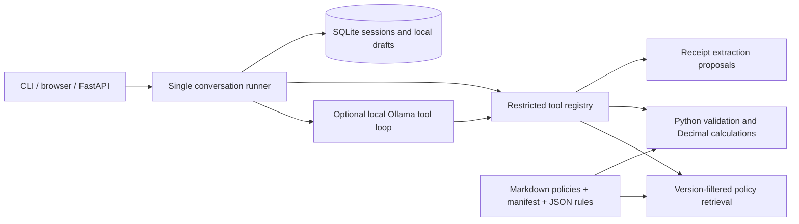

# Architecture

The runner holds a per-turn Pydantic state loaded from SQLite, not mutable global conversation
state. Tools return an `ok/data/code/message` envelope. The LLM may propose claim fields and
search policies, with at most four rounds and four calls per round. It cannot assert business
eligibility, confirm evidence, calculate, or save. The runner invokes deterministic tools after
the user turn and constructs the final amount/citation message from their results.

Offline retrieval uses sparse hashed lexical vectors; no embedding API or vector service is
required. The stored index includes a source digest. Ingestion reads the manifest; retrieval
filters by expense-date validity. Rules are selected independently from retrieval.

SQLite uses parameterized queries, optimistic revisions, foreign keys, and atomic session/draft
writes. Unique evidence hashes and canonical receipt fingerprints prevent reuse within this
assistant. State/history survive process restarts. Live model/server processes must restart.

Vercel uses the same repository operations against PostgreSQL configured through
CLAIMS_DATABASE_URL. User records persist outside the function; only the policy index is
rebuilt in /tmp on a cold start. Cloud startup requires private mode and a service token.

This is standalone: exported JSON is a local artifact. Identity, production authentication,
and organization-approved rules must be added before deployment for multiple employees.
