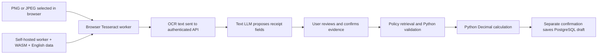

# Browser receipt OCR on Vercel

This path reads receipt photos and transaction screenshots in the user's browser with
Tesseract.js, then sends the text to the existing text-model extractor. It works with an
available text-only Groq model such as `openai/gpt-oss-20b`. Florence and Ollama do not need
to run on another machine. A compatible hosted vision model remains an optional alternative.



## Vercel settings

Set these in the Vercel project's **Production** variables, and Preview if needed:

| Variable | Value |
| --- | --- |
| `CLAIMS_APP_MODE` | `private` |
| `CLAIMS_RECEIPT_IMAGE_BACKEND` | `browser` |
| `CLAIMS_LLM_MODE` | `openai` (this names the compatible API protocol, including Groq) |
| `CLAIMS_LLM_BASE_URL` | `https://api.groq.com/openai/v1` |
| `CLAIMS_LLM_MODEL` | `openai/gpt-oss-20b`, if available to your key |
| `CLAIMS_LLM_API_KEY` | Your Groq key, entered securely |
| `CLAIMS_API_TOKEN` | Your own assistant access token, entered securely |
| `CLAIMS_DATABASE_URL` | Your persistent PostgreSQL URL, entered securely |

Keep existing working secret values; do not replace them with the descriptions above.
`private` belongs to APP_MODE, not LLM_MODE. No `CLAIMS_FLORENCE_DEVICE` or OCR-provider key
is required. Do not configure a local Ollama URL for Vercel. Deploy the latest `main` after
saving variables. Connect using the assistant token on the website; do not enter the Groq
key in the website's access-token field.

The FastAPI app serves `/assets/ocr/` itself. `vercel.json` explicitly includes the static
files; the Python wheel also contains them. No npm install or Node build command is needed
for deployment. Versioned dependencies may be cached for one day; HTML, API replies, and
the application OCR helper are not cached. The first scan downloads several MB of public
OCR assets. Reading occurs before the API request, outside the Vercel function's execution
time. The subsequent model request still has a 10-second timeout on Vercel.

## Cost and privacy

There is no OCR inference service or paid OCR key. Tesseract uses the visitor's CPU and RAM.
The app serves public assets using your hosting allowance. Groq calls, PostgreSQL storage,
and Vercel requests/bandwidth remain subject to their providers' free-tier limits. This code
does not enable billing or guarantee unlimited free hosting/model usage.

The original image stays in the browser, including its temporary preview. The OCR engine
downloads all dependencies from the app's own origin, not a third-party CDN. It does not
send image bytes to Vercel or Groq. OCR text is sent to the authenticated app API and, in
hosted AI mode, to your configured text provider. Extracted fields and session/draft history
persist in PostgreSQL. Raw images and raw OCR text are not automatically stored by the app.
Provider processing/retention policies apply to submitted text.

For `browser_ocr_text`, `evidence_hash` is SHA-256 of the UTF-8 OCR text received by the
server. It is **not an original-image hash**. Client-supplied OCR text can be edited or forged;
the server cannot verify which image or engine produced it. Canonical receipt fingerprints
remain an additional duplicate heuristic against this assistant's saved drafts. Extraction
does not establish authenticity or business eligibility.

## Test as a user

1. Connect, click **New claim**, and enter employee ID, Meal, today's date, business purpose,
   RM45.00, and the business-expense checkbox. Click **Check my claim**.
2. Choose a clear fictional PNG/JPEG showing the same date, a merchant, total RM45.00,
   currency MYR, and a unique reference. Limits: 5 MiB and 20 million pixels.
3. The image preview and browser OCR progress appear. English text is read automatically;
   the scanned text appears in the receipt textarea and is sent to the text model.
4. Compare merchant, ISO date, total, currency, and reference with the image. Correct any
   inaccurate proposed fields using the existing correction action. Confirm evidence only
   after review. Image upload and model extraction never confirm it automatically.
5. Expect RM30.00 under the fictional Meal cap, with a DEMO-ALLOWANCE v1.0 Meal citation.
   Separately confirm saving. Refresh, reconnect, and verify the saved draft is restored.

Failure checks:

- Blank/corrupt images must show an OCR error without asking the text model for fields.
- A failed new scan must block saving an old ready draft until retried or explicitly canceled
  with **Clear image preview**. You may choose the same file again.
- If OCR succeeds but the provider fails, the scanned text remains. Review it, then click
  **Extract text** to retry field extraction without scanning again, or clear the preview.
- Missing fields and claim/receipt date or total mismatches must block readiness.
- Reusing saved evidence must not create another draft. OCR changes can affect text hashes;
  duplicate checks are heuristics and are not proof of receipt identity.

## Limits and alternatives

One PNG/JPEG per draft; no PDFs, handwriting guarantee, multi-receipt splitting, table/line-item
accounting, or translation. This release ships English data only. Latin merchant names can
still be misread; other languages and complex transaction screenshots require evaluation.
Images are orientation-normalized by the browser and downscaled to a maximum 2400-pixel
edge for scanning. OCR has a two-minute deadline and can be slower on older phones.
Modern browsers must support Web Workers, WebAssembly, Canvas, and `createImageBitmap`.
Worker/asset blockers or a disconnected API produce visible errors.
If an embedded editor preview blocks workers or file dialogs, open the app's printed or
forwarded address in a regular browser on the same device.

Local alternatives: `CLAIMS_RECEIPT_IMAGE_BACKEND=florence` with `--extra florence` and a
text model; or `vision` with a compatible image model. Local Florence still does not run
inside the current Vercel function. Browser mode accepts `receipt_ocr_text` through the API;
direct `receipt_image` calls receive BROWSER_OCR_REQUIRED instead of running server OCR.
Demo model mode uses the limited labeled-text parser; arbitrary OCR may need manual field
corrections. Use a text LLM for the intended automated field-extraction experience.

## Verification

Automated tests cover bounded OCR text, source exclusivity, separate evidence confirmation,
text-model payloads, text hashing, exact caps/citations, saving/duplicates, and static asset
integrity. The browser check uses the **real vendored Tesseract worker and language model**
on generated PNG/JPEG receipts, plus blank/corrupt images, provider failure/retry, review/save,
and PostgreSQL session restoration through the HTTPS Vercel adapter. Only the text provider
is a local OpenAI-compatible stub; these checks do not prove live Groq output quality or
deployment in the user's Vercel account. Test your actual receipts and account separately.

On a development machine with OpenSSL, Chromium, DejaVu Sans Mono, and disposable PostgreSQL:

```bash
uv sync --frozen --extra dev
CLAIMS_TEST_DATABASE_URL=postgresql://postgres@127.0.0.1:55432/postgres uv run pytest
CLAIMS_BROWSER_EXECUTABLE=/usr/bin/chromium \
CLAIMS_TEST_DATABASE_URL=postgresql://postgres@127.0.0.1:55432/postgres \
uv run --with playwright python scripts/check_browser_ocr.py
```

The script creates and drops its own database schema and uses an ephemeral HTTPS certificate.
HTTP readiness trusts that certificate; Chromium trusts only its generated public-key pin.
Provider TLS checks and deployed application security are not disabled. No real receipts or
API keys are used. No external browser requests are allowed in that integration test.

### Recorded verification

Verification on 15 October 2026 (Asia/Kuala_Lumpur): 139 pytest cases passed, including
real PostgreSQL integration, plus all 17 workflow evaluations and desktop/mobile browser
checks. Real browser OCR passed PNG/JPEG field checks, blank/corrupt/animated/pixel-limit
rejections, worker-download failure/retry, provider-rate-limit retry, separate confirmation,
RM30 meal calculation, and PostgreSQL restoration through the HTTPS Vercel adapter.
The official `@vercel/python` 25.1.0 / `@vercel/build-utils` 14.21.1 builder produced a
Python 3.12 function. The generated bundle (approximately 84.5 MiB uncompressed) was tested
for asset hashes, API authentication, OCR-text review/save, and a second app instance loading
the saved PostgreSQL draft. It contained no Torch/Transformers packages. The wheel also
included the browser assets. These are local build/runtime checks, not a published production
deployment or a live Groq quality test; no Groq/Vercel credentials were present here.

## Asset maintenance

Pinned Tesseract.js 6.0.1, tesseract.js-core 6.0.0 (SIMD and non-SIMD LSTM builds), and
English `@tesseract.js-data/eng` 1.0.0 are included with upstream licenses/metadata.
See `/assets/ocr/6.0.1/manifest.json` for package URLs, npm SHA-512 integrity values, and
SHA-256 hashes of the individual files. To reproduce them from the npm registry:

```bash
python scripts/vendor_browser_ocr.py
```

The updater checks each pinned package digest before reading explicit archive members.
`.gitattributes` preserves upstream asset bytes across Windows and Linux checkouts so line
ending conversion cannot invalidate their hashes.
It is a maintenance command, not a deployment/startup prerequisite. Keep both core builds
so browsers without SIMD work, preserve license notices, and rerun real browser checks
when updating the OCR version or language files.
