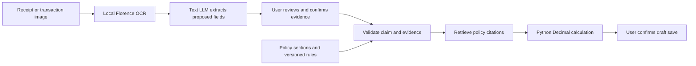

# Free local receipt and transaction-image scanning

Florence-2 reads the image; the text LLM proposes structured receipt fields; policy retrieval
and Python validation/calculation prepare the claim. Florence is not a chat agent or a text
embedding model. It does not replace the assistant's text LLM or its policy index.



## Cost and model choice

Local Florence and local Ollama have no model API fee. They use your computer's resources,
electricity, disk space, and an initial model/package download. No paid OCR account, hosted
GPU, or Hugging Face inference API is configured. Florence defaults to CPU; CUDA is optional.
CPU scanning may take time, especially on the first request. Keep the computer running.

The scanner uses Transformers' native `Florence2ForConditionalGeneration` and
`florence-community/Florence-2-base`, the converted base checkpoint used in
[the official Transformers Florence documentation](https://huggingface.co/docs/transformers/model_doc/florence2).
This is the Florence-2 base architecture, with a checkpoint compatible with native Transformers.
It does not execute remote Python code from the original `microsoft/Florence-2-base` repository.
Weights are loaded as safetensors and cached under Git-ignored `runtime/models/florence`.

## Run from VS Code on Windows

Open the repository folder and use its PowerShell terminal. Install/open Ollama and download
the text model once:

```powershell
ollama pull llama3.2:3b
ollama run llama3.2:3b "Say ready"
```

Enter `/bye` after the response. Ollama's background server must remain running.
If it is unavailable, run `ollama serve` in another terminal.

Install the optional Florence packages:

```powershell
git pull
python -m uv sync --frozen --extra dev --extra florence
```

The optional packages include PyTorch, Torchvision, and Transformers. Downloads can be large;
they are not needed for demo mode or the default Vercel deployment. Python 3.12+ is required.

Use these settings in your local `.env` beside `README.md`:

```dotenv
CLAIMS_APP_MODE=demo
CLAIMS_API_TOKEN=
CLAIMS_DATABASE_URL=
CLAIMS_LLM_MODE=ollama
CLAIMS_LLM_BASE_URL=http://127.0.0.1:11434/v1
CLAIMS_LLM_MODEL=llama3.2:3b
CLAIMS_LLM_API_KEY=
CLAIMS_RECEIPT_IMAGE_BACKEND=florence
CLAIMS_FLORENCE_DEVICE=cpu
```

Before starting the app, optionally test OCR alone on your own image:

```powershell
python -m uv run --extra florence claims ocr "C:\path\to\receipt.jpg"
```

Replace that example path with your actual PNG/JPEG. The first scan downloads the Florence
checkpoint from Hugging Face. Later scans reuse the cache. This command prints OCR text,
not a validated claim; check the reading against the image. It can run without a text LLM.

Start the full workflow:

```powershell
python -m uv run --extra florence claims ingest
python -m uv run --extra florence claims web
```

Open the address printed by the server. Keep Ollama and the assistant running.

## What staff should expect

1. Start one Meal, Parking, or Lodging claim and enter employee ID, business purpose,
   date, amount, and business-expense confirmation. Mileage uses distance/route, not a receipt.
2. Choose one clear PNG/JPEG receipt photo or transaction screenshot, at most 5 MiB and
   20 million pixels. PDF and multi-frame images are unsupported. The page previews the image
   and starts extraction. The first scan can be slow while downloading/loading the model.
3. Florence returns OCR text. The configured text model proposes merchant/payee, ISO date,
   total, currency, and receipt/transaction reference. The upload populates the receipt-review
   fields; it does not fill every expense-form field or establish business eligibility.
4. Compare all fields with the preview. If needed, apply corrections and then separately
   confirm the evidence. Missing, unreadable, ambiguous, or inconsistent information blocks
   readiness. A transaction screenshot needs the same required evidence as other claims;
   its presence alone does not establish eligibility or authenticity.
5. Applicable policy sections/citations are retrieved and Python applies the versioned rules.
   For example, a complete matching RM45 meal claim produces RM30 under the fictional cap.
6. Review the amount/details and separately confirm saving the draft. It remains unsubmitted.

An OCR failure does not approve evidence or save partial input. A new failed image blocks saving
until it is retried or canceled using Clear image preview. The original image and raw OCR text
are not retained automatically. Extracted fields, evidence hash, and conversation state persist
in SQLite. Image preview is temporary and disappears after a refresh.

With local Ollama, image scanning and field extraction stay on your computer. If you configure
Groq or another hosted text provider, Florence still scans locally but OCR text is sent to
that provider. Its quotas/billing apply. Florence is configured independently from the text
model, so a text-only model can continue handling chat and receipt-field extraction.

## Vercel

Keep `CLAIMS_RECEIPT_IMAGE_BACKEND=vision` on Vercel. The current function does not host local
Florence; selecting `florence` there fails startup with a clear configuration message.
The default Vercel install does not install the optional PyTorch/Transformers packages.
For images on Vercel, its selected hosted model must support vision and the assistant's
tool/JSON requirements. A text-only model cannot read an image through that path.

Using the Vercel website with local Florence would require an authenticated external OCR
service and HTTPS connectivity to the computer/server running it. That remote Florence
service is not part of this change. Hosted compute is not guaranteed free. Both components
can run locally with no inference API fees using the setup above.

## Verification and limitations

Verified on 14 October 2026: 105 automated tests including disposable PostgreSQL integration,
all 17 fixed-date workflow evaluations, browser image-preview/failed-scan guards, lint/format,
and package build. Optional PyTorch 2.14.1 and Transformers 5.19.0 were installed; native
Florence imports succeeded with CPU available and no CUDA device. Default web imports did
not load Torch or Transformers.

An actual `claims ocr` run on a fictional image could not download the model through this
cloud environment's network proxy (`OcrError -> ProxyError`). The CLI returned a clear error
instead of outputting invented text. Real Florence reading accuracy and live Ollama field
extraction remain unverified here; run the local scan check above on your computer.

Automated tests use fictional image data and mocked OCR/model responses to verify byte/image
validation, EXIF orientation, OCR task/limits, preserved original-image hashes, explicit review,
missing-evidence blocking, policy citations, deterministic caps, and saving. They do not prove
real OCR accuracy. Test clear/blurred photos, screenshots, faded printing, different languages,
and conflicting totals against manually checked fields before using real staff evidence.

The project's policy retrieval remains the existing offline lexical index; this change does
not add semantic embeddings. All policies remain fictional and the app remains single-user
with shared-token access. Real staff deployment needs approved policies and per-user access.
